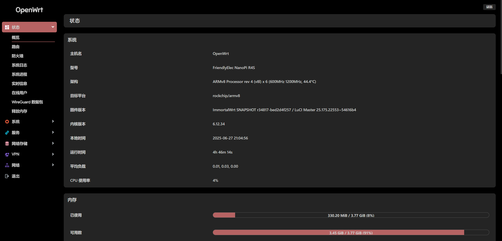

# OpenWrt — Rockchip 多设备固件云编译

基于 ImmortalWrt，通过 GitHub Actions 为 Rockchip RK3588、RK356x、RK3399、RK3328 等平台构建固件，提供标准版和 Docker 版。

- 固件下载：[Releases](https://github.com/xuanranran/OpenWrt_RockChip/releases)
- 实际编译源码：[xuanranran/immortalwrt（master 分支）](https://github.com/xuanranran/immortalwrt/tree/master)
- 上游项目：[ImmortalWrt](https://github.com/immortalwrt/immortalwrt)

### 固件升级

本仓库提供自动升级脚本，支持自动检测设备型号和选择Docker版本。

**方式一：直接运行（在线）**
```bash
bash <(curl -sL https://raw.githubusercontent.com/xuanranran/scripts/refs/heads/main/update_openwrt.sh)
```

**方式二：使用本地脚本（推荐）**
```bash
# 下载并运行升级脚本
wget https://raw.githubusercontent.com/xuanranran/scripts/refs/heads/main/update_openwrt.sh && chmod +x update_openwrt.sh && sh update_openwrt.sh
```

**功能特点：**
- ✅ 自动检测设备型号（24个RockChip设备型号）
- ✅ 支持选择标准版或Docker版固件
- ✅ 自动下载对应设备的最新固件
- ✅ SHA256校验确保文件完整性

## 支持设备

当前[编译配置](configs/immortalwrt/immortalwrt.config)启用了以下 25 个设备型号，具体可下载固件以对应 Release 的附件为准。下列标识用于匹配固件文件名：

```text
armsom_sige3
armsom_sige7
friendlyarm_nanopc-t4
friendlyarm_nanopc-t6
friendlyarm_nanopi-r2c
friendlyarm_nanopi-r2c-plus
friendlyarm_nanopi-r2s
friendlyarm_nanopi-r2s-plus
friendlyarm_nanopi-r3s
friendlyarm_nanopi-r4s
friendlyarm_nanopi-r4s-enterprise
friendlyarm_nanopi-r4se
friendlyarm_nanopi-r5c
friendlyarm_nanopi-r5s
friendlyarm_nanopi-r6c
friendlyarm_nanopi-r76s
friendlyarm_nanopi-r6s
lunzn_fastrhino-r66s
lunzn_fastrhino-r68s
radxa_rock-5a
radxa_rock-5b
xunlong_orangepi-5
xunlong_orangepi-5-plus
xunlong_orangepi-r1-plus
xunlong_orangepi-r1-plus-lts
```

## 固件默认配置

| 项目 | 默认值 |
| --- | --- |
| 管理 IP | `192.168.11.1` |
| 用户名 | `root` |
| 密码 | `password` |

## 固件下载与刷写

进入 [Releases](https://github.com/xuanranran/OpenWrt_RockChip/releases)，在对应日期的 `YYYY.MM.DD-immortalwrt` 标签下展开 Assets，根据设备标识选择固件。

| 版本 | 固件文件名 | SHA256 校验文件 |
| --- | --- | --- |
| 标准版 | 不带 `docker-` 前缀的固件 | `sha256sums` |
| Docker 版 | 带 `docker-` 前缀的固件 | `docker-sha256sums` |

例如，NanoPi R4S 标准版固件名为 `immortalwrt-rockchip-armv8-friendlyarm_nanopi-r4s-squashfs-sysupgrade.img.gz`，Docker 版在此文件名前增加 `docker-`。

刷机方法可参考仓库内的 [DoorNet2 eMMC / SD 卡刷机说明](data/emmc.md)。该教程针对 DoorNet2，其中的 Loader、磁盘路径和按键操作不能直接套用到其他设备，请以对应设备的刷机说明为准。

## 自行编译

本仓库提供两个编译工作流：

| 版本 | 工作流名称 | 工作流文件 |
| --- | --- | --- |
| 标准版 | `immortalwrt-rockchip-master` | [immortalwrt-rockchip.yml](.github/workflows/immortalwrt-rockchip.yml) |
| Docker 版 | `immortalwrt-rockchip-docker-master` | [immortalwrt-rockchip-docker.yml](.github/workflows/immortalwrt-rockchip-docker.yml) |

两个工作流均使用 `self-hosted` Runner，需要先准备好具备 OpenWrt 编译环境的 Linux 自托管 Runner。Fork 仓库后，在 Actions 页面选择对应工作流，通过 **Run workflow** 手动触发编译；也支持 `repository_dispatch`，当前未启用定时构建。

主要配置入口：

- [固件编译配置](configs/immortalwrt/immortalwrt.config)：设备型号和软件包选择。
- [自定义脚本](scripts/immortalwrt/immortalwrt.sh)：默认 IP、Shell 等构建设置。
- [首次启动设置](scripts/immortalwrt/snapshots-init-settings.sh)：主题、时区等初始化设置。

## 固件展示



## 特别提示

- **因精力有限，不提供技术支持和教程等相关问题解答，不保证完全无 BUG！**
- **本人不对任何人因使用本固件所遭受的任何理论或实际的损失承担责任！**
- **本固件禁止用于任何商业用途，请务必严格遵守国家互联网使用相关法律规定！**

发现 BUG 请在 [Issues](https://github.com/xuanranran/OpenWrt_RockChip/issues) 提交，并附上设备型号、固件版本、复现步骤及相关日志。

## 鸣谢

特别感谢以下项目：

- [OpenWrt](https://github.com/openwrt/openwrt)
- [Lean's OpenWrt / LEDE](https://github.com/coolsnowwolf/lede)
- [ImmortalWrt](https://github.com/immortalwrt/immortalwrt)
- [P3TERX / Actions-OpenWrt](https://github.com/P3TERX/Actions-OpenWrt)
- [SuLingGG / OpenWrt-Rpi](https://github.com/SuLingGG/OpenWrt-Rpi)
